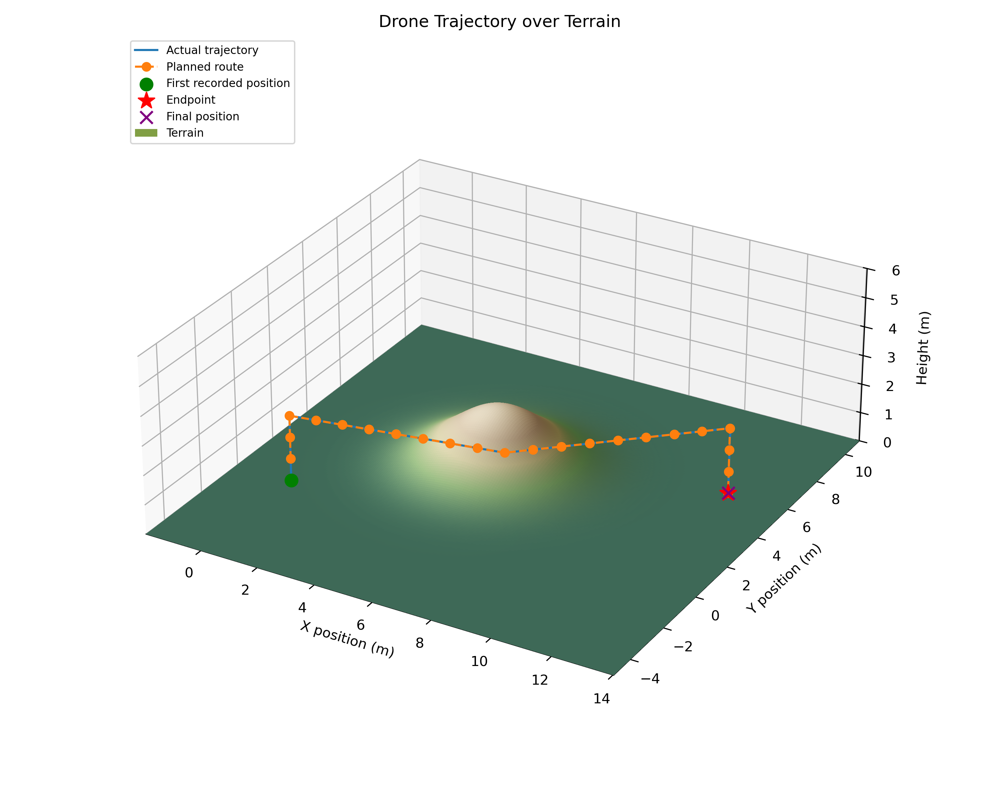

# Drone Dynamics and Control Simulator

Quadrotor simulation with PID control, terrain-aware A* routing, a seeded
200 m × 200 m Perlin landscape, wind and automatic landing. Custom physics and
Gym/PyBullet provide mission comparisons and paired acceleration data for a
future learned correction: `a_corrected = a_custom + delta_a_ML`.



## Run

Use **Python 3.10** and **Git**. From the project folder, in PowerShell:

```powershell
python -m venv .venv
.venv\Scripts\Activate.ps1
python -m pip install --upgrade pip
python -m pip install -r requirements.txt
python -m drone_sim.main
```

Requirements include both backends and pin the verified Gym revision. A clean
installation has not yet been verified. Select the environment in VS Code.

## Settings

- `drone_sim/main.py`: destination, minimum world altitude, routing, terrain,
  wind, landing mode and `PHYSICS_BACKEND` (`simulation`, `gym_pybullet`, `compare`).
- `drone_sim/configuration/parameters.py`: PID gains, physical properties,
  clearance, flight limits, `LANDSCAPE_*` settings and `TERRAIN_SEED`.
- Missions run until arrival, then wait `ARRIVAL_WAIT_TIME` (1.5 simulated
  seconds). Explicit `duration=` limits are available for trials.

Compare mode runs independent missions on both backends. Graphs currently show
only the simulation run. Brief module descriptions are in each `__init__.py`.

## Outputs and regression data

Graphs and PID reports are saved in `outputs/`. Each comparison creates a new
`outputs/training/comparison_<timestamp>_<id>.npz` file.

During the Gym mission, the custom model predicts one step from the same
PyBullet state, motor commands, external force and timestep. Schema 3 exports:

- **`X`**: 20 inputs—position, velocity, Euler angles, body angular velocity,
  four applied motor speeds, world force and timestep.
- **`y`**: three world acceleration residuals, `a_pybullet - a_custom`, in m/s².
- Both accelerations, next states, contact flags, terrain and JSON metadata.
  `X_columns` and `X_units` describe the inputs; `paired_*` keeps diagnostic rows.

```python
import numpy as np

with np.load("outputs/training/<episode>.npz", allow_pickle=False) as data:
    X, y = data["X"], data["y"]
```

Accelerations use velocity change divided by timestep. Independent mission
trajectory differences are evaluation results, not regression labels. Older
schema 1/2 files do not contain paired `X`/`y`. Contact filtering needs the fix
listed below before treating current exports as fully airborne training data.

## PID tuning

```powershell
python -m tools.auto_tune_pid --backend simulation
# Broader search; apply gains only when validation passes:
python -m tools.retune_pid --expanded --backend simulation --apply
```

Attitude-first tuning is followed by joint mission-level refinement. Separate
validation cases run on both backends. Reports compare tracking error,
overshoot, settling, saturation, smoothness, touchdown speed and success.
Recommendations go to `outputs/optimized_pid_gains.json`; standard tuning does
not change `parameters.py`. The latest accepted gains have been applied.

## Acknowledgments

The Gym backend uses [gym-pybullet-drones](https://github.com/learnsyslab/gym-pybullet-drones)
by Jacopo Panerati and contributors ([MIT license](https://github.com/learnsyslab/gym-pybullet-drones/blob/a8c238c21c7586ee1735bafb358a4d5637402f14/LICENSE)),
built on [PyBullet/Bullet Physics](https://github.com/bulletphysics/bullet3)
([zlib license](https://github.com/bulletphysics/bullet3/blob/master/LICENSE.txt)).

## Future work

1. **Fix contact filtering and regenerate data.** Detect positive contact force
   even at small positive separation, including contacts within substeps. A
   replay confirmed that the current filter retained a touchdown impulse.
2. **Collect diverse regression episodes.** Vary routes, terrain seeds, wind and
   maneuvers. Split training/validation by episode or seed to avoid leakage.
3. **Train and evaluate the correction model.** Regress `X → y`, add its predicted
   acceleration before custom-model integration, and compare corrected versus
   uncorrected flight against PyBullet on unseen missions. This is not yet implemented.
